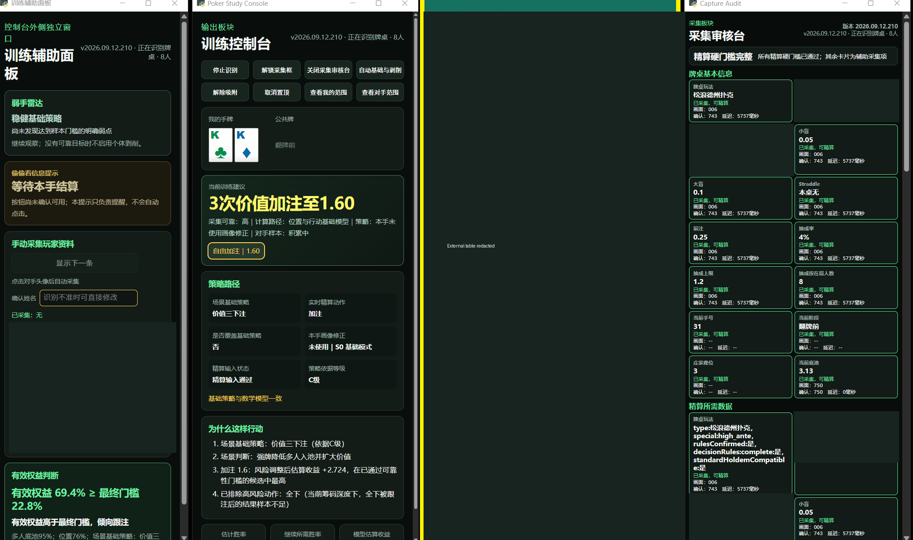

# Poker Study Tool · 德州扑克训练工具

Windows 桌面识别、牌局状态整理与复盘训练的实验性源码项目。

本仓库包含屏幕采集、文字与牌面识别、动作链、训练建议和复盘界面的源码。当前发布包提供无需私人数据的离线牌型演示；桌面版依赖的识别素材、模型和策略数据库没有随源码分发，不能仅克隆本仓库就完整复现桌面功能。

## 界面参考与完整使用说明



上图由项目所有者提供，用于说明界面布局。公开版本已遮挡外部牌桌及相关身份信息区域；它是单帧参考，不是准确率、策略质量或盈利证明。牌桌为外部输入界面，不是本项目提供的游戏。

请阅读 [逐面板功能、数据依据与使用边界](docs/USER_GUIDE.md)。说明同时覆盖截图下方未展示的内容，以及“我的范围”和“对手范围”两个扩展窗口。截图不表示本源码包已经包含完整桌面运行资源。

## 先运行离线演示

安装 Node.js 22 LTS 或更新的受支持版本，在仓库根目录运行：

```powershell
node examples/offline-demo.js
```

演示使用人工构造的手牌，调用项目现有牌型比较模块，展示公共牌与双方手牌如何决定胜负。不读取屏幕、不使用账户、不启动求解器，也不代表策略或盈利能力验证。

## 项目结构

| 文件/模块 | 职责 |
| --- | --- |
| `desktop.py` | Windows 桌面入口及流程协调 |
| `capture_layer.py`、`recognition_layer.py` | 图像采集与识别处理 |
| `hand_state_layer.py`、`card_state_layer.py` | 牌局状态与牌面状态 |
| `action_ledger_layer.py`、`action_chain_engine.py` | 动作证据与动作链 |
| `poker-core.js`、`decision-layer.js` | 扑克计算与建议接口 |
| `wepoker-review.html` 及关联脚本 | 训练与复盘界面 |
| `v4/` | 被桌面入口引用的策略及契约代码 |
| `docs/` | 安装、资源边界、导出清单与验证记录 |

## 桌面版开发环境

目标环境为 Windows，原开发环境使用 Python 3.12。以下依赖声明根据源码整理，未在新机器上验证；详见 [安装说明](docs/INSTALL.md)。

```powershell
py -3.12 -m venv .venv
.\.venv\Scripts\python.exe -m pip install -r requirements.txt
```

请先查看 [缺失资源与发布边界](docs/RELEASE.md)，再决定是否恢复桌面功能；直接启动可能缺少模板或模型。完整的对局录像、玩家资料及历史数据不属于这个源码包。

## 运行轻量检查

```powershell
node scripts/check.js
py -3.12 -m pip install -r requirements-dev.txt
py -3.12 -m pytest -q test_action_ledger_layer.py test_card_state_layer.py
```

只覆盖随包选择的轻量回归，不能替代识别盲测、端到端回放和实际桌面验收。当前整理时的检查结果见 [验证记录](docs/VALIDATION.md)。

## 已知限制

- 屏幕识别受分辨率、界面主题、遮挡和素材覆盖影响；未知字段应保持未知。
- 工程测试通过不等于建议正确。本仓库没有提供完整 GTO 或净收益验证。
- 桌面源码包含历史实时计算与外部求解器接口；离线演示不使用它们，本次也未启动它们。
- 本项目用于学习与离线复盘；使用其他平台前应自行确认其规则允许的功能。

## 贡献与使用权

欢迎提供可复现的问题、脱敏或人工构造的样例，以及小范围修复。请勿提交真实玩家资料、访问凭据或整段私人录像。参见 [贡献说明](CONTRIBUTING.md)。

尚未选择开源许可证，也未完成全部源码和素材的权属审查。本次整理不授予额外复制、修改或分发许可，建议先以私有仓库保存。公开源码与采用开源许可证是两个不同决定，见 [第三方说明](THIRD_PARTY_NOTICES.md)。
