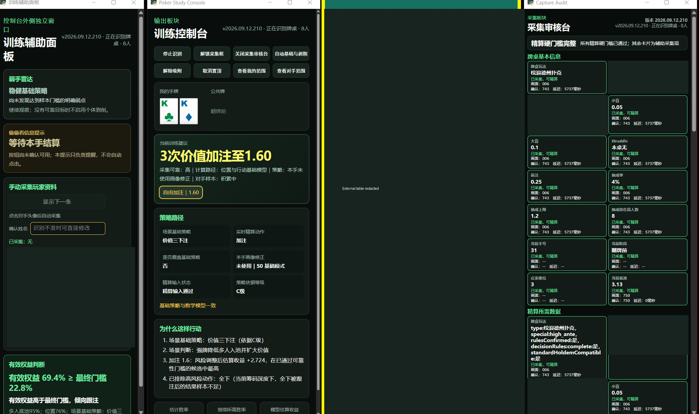

# 逐面板使用说明与依据

本文依据仓库中的界面模板、渲染函数及后端调用编写，解释“功能如何实现、用什么数据、适合做什么”。代码存在不等于功能已通过端到端验收；经验规则和模型估计不等于已证实的扑克结论。

## 1. 先看懂整张图

从左到右分别为训练辅助面板、训练控制台、外部牌桌、采集审核台。辅助面板解释样本和权益；控制台给出当前建议与计算路径；牌桌提供可见画面；审核台解释输入值及其确认状态。右侧和左侧都有滚动区域，截图没有展示全部内容。

截图版本标为 `2026.09.12.210`；本说明以当前导出代码为准。单帧不能确认画面、底池、建议是否属于同一按钮时刻。公开版本已遮挡外部牌桌与身份信息区域，原图未加入公开版本。

推荐阅读顺序：先在审核台核对输入，再看控制台策略路径，最后读建议与辅助面板。只看黄色大字容易把输入错误或模型假设当作可靠结论。

## 2. 训练控制台：操作与建议

实现入口：[界面](../wepoker-review.html)、[逻辑](../wepoker-review.js)、[后端](../desktop.py)。后端方法名是定位代码用的关键词。

### 2.1 顶部操作

| 功能 | 作用和操作 | 数据或实现依据 | 限制 |
| --- | --- | --- | --- |
| 版本与识别状态 | 查看当前程序版本、识别状态及桌况 | 后端连接与采集状态 | “正在识别”只代表流程运行，不代表所有字段正确 |
| 启动识别／停止识别 | 开始采集；停止后保留最后结果 | `start_recognition` / `stop_recognition`，`toggleCapture` | 停止后留在页面上的数字不再是实时数据 |
| 锁定／解锁采集框 | 固定识别区域，或恢复区域调整 | `lock_capture_box` / `unlock_capture_box` | 牌桌移动、缩放后需重新核对区域；锁定不校验内容 |
| 打开／关闭采集审核台 | 切换右侧输入审计窗口 | `toggle_audit_window` | 只改变窗口显示，不替代数据校验 |
| 自动基础与剥削／另一策略模式 | 切换 `auto` 与 `strict_exploit`，清空前端相关计算缓存 | `toggleStrategyMode`、`set_strategy_mode` | 模式不强制使用个体画像；本手是否实际修正以“本手画像修正”为准 |
| 吸附窗口／解除吸附 | 控制辅助窗口是否随布局吸附 | `set_window_docking` | 窗口排布功能，不影响策略依据 |
| 窗口置顶／取消置顶 | 控制主窗口组显示层级 | `set_windows_topmost` | 不提高识别或计算优先级 |
| 查看／关闭我的范围 | 打开本人场景范围及实际入池统计 | `toggle_hero_profile_window` | 详见第5节 |
| 查看／关闭对手范围 | 打开对手可能手牌分布 | `toggle_opponent_hands_window` | 不是读取对手隐藏底牌，详见第6节 |

### 2.2 牌面、建议与下注尺度

| 显示项 | 作用 | 依据与解释 |
| --- | --- | --- |
| 我的手牌 | 核对本人两张牌的点数与花色 | `state.heroCards`；这是识别输出，必须和输入画面核对 |
| 公共牌／翻牌前 | 确定当前街和可用公共牌 | `state.boardCards`；空牌面可能是翻牌前，也可能尚未取得有效识别，需结合审核台 |
| 当前训练建议 | 展示当前计算路径形成的动作 | `renderDecision`、策略契约与展示层；可能来自场景基础规则或模型收益比较，不能一概称为精确解 |
| “3次价值加注至1.60”等动作文字 | 帮助理解动作类别与目标尺度 | 此类“3次”通常指三下注，即首次加注后的再加注，不是连续点击三次。金额的具体含义还须核对平台“加到”或“额外投入”的按钮规则，不能盲照截图操作 |
| 采集可靠 | 提示输入可靠状态 | 主要取 `lastState.reliable`；“高”不是建议正确率，也不是模型校准概率 |
| 计算路径 | 区分仅基础策略、位置与行动基础模型、实测场景、受限精算等来源 | `calculationTier` 与输入门槛映射；“等待正式精算”不表示已经完成收益比较 |
| 策略／本手画像修正摘要 | 解释本手是否使用对手画像 | 实际选择及画像使用状态，不应仅凭策略模式按钮判断 |
| 对手样本：不足／积累中／稳定 | 粗略提示样本成熟程度 | `PokerCore.hudMetrics` 的样本层级；稳定不等于对手不会改变策略 |
| 快捷尺度、自由加注标签 | 将识别到的快捷比例换算为展示金额，并标出接近推荐值的尺度 | `renderRaiseOptions` 使用 `min(有效筹码, 跟注额 + (底池 + 跟注额) × 比例)`；接近判定有容差。标签由 HTML `span` 渲染，是参考标识，不是自动下注按钮 |

### 2.3 策略路径：区分基础规则与计算覆盖

| 字段 | 作用 | 依据及边界 |
| --- | --- | --- |
| 场景基础策略 | 展示未进行本手数学覆盖前的路线 | `strategyContract.baselineAction`；翻前使用人数、位置、前序动作、筹码、抽成、压力等条件 |
| 实时精算动作 | 展示模型比较所得动作，或明确“未运行” | `mathRan` 与 `mathAction`；界面“精算”是项目名称，不保证完整博弈求解或无误差 |
| 是否覆盖基础策略 | 解释最终为什么保持或改变基础路线 | `overriddenBy`、`baselineRequiresRealtimeMath`、`overrideReason`；部分覆盖逻辑要求收益提升超过内部不确定尺度，这不是统计置信区间证明 |
| 本手画像修正 | 显示实际使用的座位、修正权重，或未使用及阶段 | `exploitApplied`、`exploitSeats`、`exploitWeight`；截图“S0 基础模式”表示未使用个体画像，并非所有数据都为空 |
| 精算输入状态 | 区分完整输入、仅基础策略、官方金额受限精算及未形成结果 | `inputGate` 和 `mathRan`；受限模式只比较实际允许的候选，不能理解为完整局面已还原 |
| 策略依据等级 | 提供规则来源分级的入口 | `evidenceLevel`，悬停可查看 `evidenceSource`。当前翻前规则默认 C，源码写明“现金桌经验规则，待数据校准”；C不是第三方评级。未逐项核实的其他等级不在此赋予权威含义 |
| 路径底部说明 | 解释保持、覆盖、等待或分歧 | `overrideReason`；“基础策略与数学模型一致”只表示内部两条路径一致，不是外部验证 |

### 2.4 为什么这样行动与三项数值

“为什么这样行动”由 `decisionReasons` 生成，包括基础路线及依据、场景判断、候选收益、排除动作及理由。出现“全下被跟注后的样本不足”表示该候选被门槛限制，不是证明全下必错。理由跟随当前模型假设；如果输入错，文字也可能自洽但错误。

| 指标 | 来源与用途 | 不应怎样理解 |
| --- | --- | --- |
| 估计胜率 | 根据本人牌、公共牌和推定对手范围计算；存在 `low/high` 时展示范围 | 不是读取真实对手底牌后的确定胜率；展示区间不自动等于正式统计置信区间 |
| 继续所需胜率 | 即时底池赔率及该路径的抽成口径；翻前标题明确为未扣抽成即时门槛 | 不包括所有未来街下注风险，不能直接当完整策略答案 |
| 模型估算收益 | `decision.ev`，正式比较未运行时应为空；金额单位随输入筹码口径 | 正值不是保证盈利，也不是本手结算。截图理由中的风险调整收益与主卡收益可能口径不同，需以对应字段为准 |

没有抽成、边池和未来下注时，跟注的即时盈亏平衡胜率可写为 `跟注成本 / (跟注前底池 + 跟注成本)`。实际模型还可能处理抽成、可争夺底池、范围和权益兑现，因此不可用这个简式替代所有界面指标。

等待新输入时数值可能带“（上次）”，那是留存结果。观赛模式只记录，不提供本人建议。特殊保险场景的“不买保险”是代码内固定资金管理提示，并未逐个验证平台保险报价；发牌动画期间等待新牌，不形成新决策。

## 3. 训练辅助面板

依据：[界面](../training-support.html)、[逻辑](../training-support.js)、[权益生成](../wepoker-review.js) 中的 `buildTrainingDecision`。

### 3.1 弱手雷达

| 项目 | 作用与依据 | 边界 |
| --- | --- | --- |
| 稳健基础策略 | 没有合格目标时显示默认路线及停止修正原因 | 没发现弱点不等于桌上没有弱手 |
| 目标姓名、座位、弱点标签 | 显示后端 `exploitStrategy.target` 的候选目标 | 座位和身份绑定错误会污染画像，应先核对采集 |
| 仅观察／已达使用门槛 | 区分初筛和允许使用的阶段 | 不是已经证明该玩家长期可剥削 |
| 证据文字 | 展示目标的 `evidence`，解释为什么列为候选 | 应结合样本数量、场景是否相同及时间稳定性 |
| 最大修正百分比 | 显示本手允许的最大权重 | 上限不等于实际使用；实际值看控制台策略路径 |
| 继续观察／可考虑换桌 | 无目标或观察成熟后的提示 | 换桌是程序启发式建议，不是已验证收益优化结论 |

当前 [画像配置](../exploit_strategy.json) 包含总体疑似/确认样本门槛50/100、反应样本门槛20/30，以及阶段权重限制。它们是项目参数，不是普适的统计显著性标准；前端也有其他样本层级，不应混为一个统一门槛。

### 3.2 偷偷看信息提示

| 状态／项目 | 作用与代码依据 |
| --- | --- |
| 等待本手结算 | `peek.available` 尚未确认，不能当作功能可用 |
| 信息缺口较大／较小 | 前端把仍在局对手有样本少于20，或对手人数至少3，作为较大缺口的启发式条件 |
| 本次费用 | 来自采集的 `peek.cost`，未识别时不能凭显示默认值认定免费 |
| 已使用、累计次数和费用 | 记录手动使用后采集到的公开信息，来自 `usageCount`、`totalCost` |

该模块没有计算“信息价值是否超过费用”，也不自动点击。出现“缺口较大”不是购买建议，“缺口较小”也不是证明无价值。

### 3.3 手动采集玩家资料

| 功能 | 操作与作用 | 依据及限制 |
| --- | --- | --- |
| 点击牌桌头像后采集 | 用户手动打开资料弹窗，程序识别统计项 | `profileStatisticsCapture`；不是绕过权限获取数据 |
| 识别结果摘要 | 核对姓名、本级别手数、主动入池率、总手数、加注入池率 | 来自弹窗 OCR；不同平台的统计口径可能不同 |
| 确认姓名输入框 | OCR不准时修改姓名，避免错绑 | `profileNameInput`，最长40字符；修改姓名不等于修正所有统计值 |
| 座位卡片 | 把当前资料明确绑定到对应对手 | `assign_opponent_statistics_seat(seat, name)`；可见座位从1计数，部分内部索引从0计数 |
| 显示下一条 | 有待匹配资料和排队项目时切换待处理记录 | `show_next_profile_statistics`；灰色禁用通常表示没有满足切换条件的记录，不是未实现 |
| 已采集／未采集 | 提示哪些当前对手完成确认，防止漏采或重复绑定 | `confirmedProfileSeats` 与当前座位名单；当前版本列表不包含本人，本人资料由“我的范围”窗口显示 |

### 3.4 有效权益判断

在正式计算完成、有正跟注额、且存在可比较跟注候选时，模块才应显示结论。优先使用候选的 `effectiveEquity` 和 `requiredWithSafety`；否则调用 `PokerCore.trainingDecisionValue`。因此它不是简单重复上面的原始胜率。

| 项目 | 作用与解释 |
| --- | --- |
| 有效权益 | 模型对原始权益及兑现因素处理后的结果；可能受多人底池、位置、筹码深度、动作链和范围样本影响 |
| 最终门槛 | 当前计算路径给出的含安全因素门槛，不必等于裸底池赔率 |
| ≥／＜颜色与比较 | 比较有效权益减门槛的正负；绿色仅表示模型比较非负 |
| 倾向跟注／弃牌／临界决定 | 直接候选路径以差值至少正负2个百分点区分明显倾向，中间区域为临界；其他后备路径以其返回结论为准 |
| 下方因素解释 | 列出部分低于100%的兑现因子或理由，帮助发现结论依赖什么假设 |
| 等待本人抉择／未形成结论 | 输入、正式计算或跟注候选不足时不强行给数值 |

截图的“69.4% ≥ 22.8%”仅说明当时显示的模型比较。它不是实际胜率证明，也不是跟注优于加注的证明；不同动作还需要另行比较收益。

## 4. 采集审核台

依据：[界面](../capture-audit.html)、[逻辑](../capture-audit.js)，后端 `audit_snapshot`。它用于找输入错误，不是独立于采集模块的第二套真值系统。

### 4.1 顶部门槛与每张数据卡

| 项目 | 作用与依据 |
| --- | --- |
| 精算硬门槛完整／正式精算被阻止 | `decisionInputs.inputs` 中所有 `blocking !== false` 的项必须状态为 `ok`；否则列出阻塞项 |
| 所有硬门槛通过，其余为辅助项 | 解释为何部分辅助卡片缺失仍可能允许计算；不是证明全链路无错误 |
| 已采集，可精算 | 当前字段状态 `ok`；对于基本信息，某些没有独立证据卡的字段仅根据值是否存在生成状态，因此绿色不能代替人工核对 |
| 未采集／待确认／待匹配座位／规则冲突／采集中 | 分别提示缺失、复核、身份绑定、冲突或未完成状态 |
| 画面时间 | `observedAt` 转为本地时钟；它是被标注的观察时刻，不自动等于原录像精确时间码 |
| 确认时间 | `confirmedAt`，或回退到 `capturedAt` |
| 延迟 | 优先使用 `latencyMs`；否则确认时间减观察时间，负差截为0。它不是完整“屏幕出现到建议显示”的端到端延迟 |
| 鼠标悬停说明 | 解释字段含义；当前代码悬停数据卡时暂缓部分卡片刷新，便于阅读，离开后恢复 |

### 4.2 牌桌基本信息：所有卡片

| 字段 | 来源和作用 |
| --- | --- |
| 牌桌玩法 | 可见玩法解析为规则上下文；决定是否允许标准德州扑克路径及特殊规则 |
| 牌桌号 | 识别桌号，辅助判断回原桌还是换新桌，避免跨桌串用状态 |
| 盲注原文 | 保留屏幕显示原文，供复核解析是否正确 |
| 小盲／大盲 | 强制下注基准；大盲还用于筹码深度与部分统计单位 |
| Straddle | 玩法中的额外强制下注；无值且确认时显示本桌无，当前展示逻辑人数不超过3时显示本手关闭 |
| 前注 | 开局前投入的金额，影响底池与投入计算 |
| 抽成率 | 牌桌抽成比例；依据项目抽成表及盲注匹配，不是自动获得的平台官方保证 |
| 抽成上限 | 本手扣费封顶值，随级别和人数口径确定 |
| 抽成按在局人数 | 解释抽成上限使用哪个人数；不是仅显示座位总数 |
| 当前手号 | 程序内部 `handId`，用于隔离不同手牌；不保证等于平台官方手牌编号 |
| 当前阶段 | 翻牌前、翻牌、转牌或河牌，决定牌面和动作应如何解释 |
| 庄家座位 | 公开显示从1开始的座位号；与内部 `dealerIndex` 的从0索引不要混用 |
| 当前底池 | 当前识别/状态输出的底池金额，影响赔率和下注尺度；与桌面不符时应先查这个输入 |

### 4.3 精算所需数据

卡片由后端输入清单动态生成，具体项目和阻塞标记随场景变化。以下是前端帮助表明确支持的输入，不代表每手都必然出现所有卡片。

| 输入 | 作用及依据 |
| --- | --- |
| 玩法、桌号、盲注、前注、抽成参数及来源 | 确定当前规则与成本上下文；抽成来源只有匹配成功才满足相应门槛 |
| 本人位置 | 从庄家和有效座位推导，影响基础起手范围 |
| 跟注额 | 本人继续需要补齐的成本，关系到合法动作和跟注门槛 |
| 本人筹码／对手筹码 | 决定可投入上限；对手筹码只应覆盖仍在局目标 |
| 有效筹码 | 本人与对手之间实际能够争夺的筹码；多人局可能需逐对处理和边池口径，不宜只看一个最大值 |
| 完整动作链 | 从本手开始按规则整理动作；缺少前序动作可能误判加注次数和轮次 |
| 本人手牌／公共牌 | 决定牌力、组合排除和范围权益 |
| 正式按钮与快捷尺度 | 当前画面允许的弃牌、让牌、跟注、加注及尺度；程序建议不能超出合法动作 |
| 底池、庄位等其他卡片 | 用于对应计算输入和状态确认；含义与基本信息区相同，但应核对是否属于本人按钮时刻 |

### 4.4 玩家信息与数据统计

每张玩家卡显示座位和姓名、筹码、当前动作/状态、本手路线、已采集的平台本级别手数、主动入池率、总手数与加注入池率。玩家值来自 `snapshot.seats`，路线来自动作列表，平台资料来自 `opponentProfiles`。空座位或未知姓名不是其他玩家的别名；必须先确认绑定，不能用统计看起来合理来反证身份正确。

### 4.5 本手完整行动记录

逐条显示手号、街、顺序、座位、姓名、动作与金额。来源为 `snapshot.actions`；`orderConflict` 会高亮冲突。用它检查漏动作、重复动作、街切换和座位错误。“完整”是面板名称，不是对该次识别的完整性保证；应与录像人工对照。

### 4.6 偷偷看与摊牌真值

| 项目 | 作用与限制 |
| --- | --- |
| 状态 | 区分等待、按钮可用、已触发并采集；按钮可用不等于已经使用 |
| 本次公开底牌 | 列出手动打开或公开画面中采集的座位、姓名及牌；只能记录可见内容 |
| 累计使用与费用 | 当前记录的次数与费用，不是平台账单对账 |

“真值”指公开底牌可作为核对依据，但底牌识别本身仍可能出错；样本只来自亮牌或使用过该功能的局面，存在选择偏差，不能直接代表全部隐藏牌分布。

## 5. 我的范围窗口

截图未展开；依据：[界面](../hero-profile.html)、[逻辑](../hero-profile.js)、[范围模型](../hero-range-model.js)。

### 5.1 当前场景与基础范围

| 功能 | 作用与依据 |
| --- | --- |
| 姓名、采集时间、采集状态 | 展示本人资料识别结果；打开本人资料弹窗后自动更新 |
| 置顶／取消置顶 | 单独控制本窗口层级，不改变范围 |
| 人数、本人位置、前序行动、有效筹码、抽成、压力 | 解释当前范围适用的条件，来自 `rangeDecision.rangeContext` |
| 当前场景起手范围 | 13×13共169类：对角线对子，上方同花 `s`，下方非同花 `o`；不是169个等概率组合 |
| 加注／跟注／让牌／弃牌／条件动作颜色 | 展示每类手牌在当前基础规则下的路线；条件动作要等具体金额和本手计算 |
| 点击手牌格 | 查看该格动作、理由、依据等级和是否要求实时计算 |
| 当前手牌高亮 | 根据已识别手牌类别定位格子，不代表自动确认牌面正确 |
| 汇总动作数量与场景说明 | 解释169格中各类别数量和更新状态；换手/过渡帧可能保留上一完整场景，并明确提示，不能当作新手牌范围 |

### 5.2 本人实际入池范围

| 功能 | 作用与依据 |
| --- | --- |
| 全部／前位／中位／后位／盲位 | 筛选不同位置的实际观察记录 |
| 只看已入池 | 隐藏未记录入池的格子，不删除样本 |
| 每格“入池次数/发到次数” | 记录行为频率，来源为后端矩阵；不是该牌胜率 |
| 169类／1326组合 | 解释起手牌类别与未考虑已知牌时的具体组合总数，不是已采集数量 |
| S0–S4颜色层级 | 发到次数达到5、15、30、60时逐档增强；是预设可视化层级，不是置信检验 |
| 开始／暂停统计 | `set_hero_range_collection` 切换采集开关；不会替你开始或停止平台对局 |
| 清空 | `clear_hero_range_statistics` 清除本人的范围统计；不是筛选重置，使用前应保留需要的记录 |

### 5.3 本人平台数据与长期调整提示

该折叠区通过 `renderStatistics` 展示识别到的平台统计，长期提示来自后端 `observations`，不是这些数值自然推导出的确定结论。

| 统计项 | 通常含义与用途 |
| --- | --- |
| 本级别手数／总手数 | 查看样本规模；不同级别不可直接视为同质数据 |
| 主动入池率（VPIP） | 主动投入参与底池的频率，辅助判断松紧 |
| 加注入池率（PFR） | 翻前主动加注频率，辅助判断主动程度 |
| 3次下注率 | 有再加注机会时的三下注频率，不是所有手数中“下注三次”的比例 |
| 持续下注率 | 常见为翻前加注者翻后继续下注的频率；机会口径以平台为准 |
| 摊牌率／摊牌胜率 | 到摊牌的频率、摊牌后获胜比例；两者分母不同，不能互换 |
| 激进度 | 平台给出的进攻性指标；本窗口不重新证明平台公式 |
| 场均带入／场均战绩 | 平台口径的场次均值，不能代替逐手收益审计 |
| 每百手盈亏 | 常以大盲/百手表示；必须先核对平台单位、样本与抽成口径，OCR值不等于独立收益验证 |

以上为常用术语解释；本工具展示外部平台值，未在窗口里重算这些统计的分母，因此具体含义以平台说明和解析结果为准。

### 5.4 我的策略漏洞

将正式建议与实际动作配对，显示样本数、同类机会、偏离次数/比例、主要位置及需要关注状态。前端默认至少15个同类可比较机会才进入判断，但后端可返回不同门槛。清空漏洞样本调用 `clear_hero_strategy_comparisons`，与清空范围统计是两项操作。

“偏离”只表示没有照模型建议行动；模型可能错误，玩家也可能有界面未记录的信息。因此应叫复盘线索，不能把它当已经证实的扑克漏洞。

## 6. 对手范围统计窗口

截图未展开；依据：[界面](../opponent-hands.html)、[逻辑](../opponent-hands.js)、[计算线程](../opponent-hands-worker.js)。

| 功能 | 作用与数据依据 | 边界 |
| --- | --- | --- |
| 手号、街、公共牌 | 确认当前分析上下文 | 切换手牌后核对是否及时更新 |
| 置顶 | 单独控制窗口层级 | 不改变范围 |
| 座位标签切换 | 在仍在局对手间切换 | 已弃牌或非活动对手不在当前活动列表中 |
| 姓名、位置、当前动作 | 告诉用户正在分析谁、所处位置及动作 | 身份和动作来自识别/动作链，不是独立人工真值 |
| 80%核心范围 | 显示承载模型主要权重的核心组合数量与合法组合总数，辅助判断范围集中程度 | 不是80%识别正确率，也不是某手牌80%命中概率 |
| 正式剥削权重 | 显示满足使用条件后的画像修正权重 | 未满足动作修改条件时显示0；它不是胜率或利润提升 |
| 亮牌校准状态/权重 | 表明摊牌样本是否满足程序校准条件 | 校准来自有偏样本，不能自动推广到全部未亮牌 |
| 169类矩阵 | 每格展示模型权重、剩余合法花色组合，亮度表示相对权重 | 悬停读具体组合数；格子外观为按钮但当前没有逐格点击展开处理，不要期待点击产生新分析 |
| 高／中／低／极低／排除 | 帮助快速浏览模型分布 | 低不是不可能；排除是已知牌约束下无合法组合 |
| 口袋对子／同花／非同花 | 按起手牌结构聚合当前范围 | 与实际对手牌仍可能有偏差 |
| 两对及以上／一对／同花或顺子听牌／高牌弱牌 | 翻后按当前牌面描述范围牌力结构 | 成牌和听牌概念可能交叉，不应未经检查就把各条百分比相加为100% |
| 范围怎样变化：动作链 | 用翻前/翻后动作、大小和场景解释范围更新 | 错误动作会沿链条影响后续分布 |
| 分阶段80%核心范围 | 对比每个动作后的集中程度与标签 | 是同一模型的更新过程，不是外部证实对手确实如此收紧 |
| 总体样本进度 | 前端展示20/50/100/200各档进度 | 展示档位不等于全部正式使用门槛 |
| 当前场景动作／亮牌样本 | 展示5/15/30/60各档进度，提醒总体样本多不等于此场景足够 | 仍需核对身份、场景和校准状态 |

## 7. 外部牌桌：哪些不是本项目功能

截图中央牌桌中的昵称、头像、余额、下注标记、庄家D、底池、公共牌区、本人手牌、倒计时，以及弃牌/跟注/自由加注/快捷比例等按钮，来自外部平台。平台菜单、红包、保险或其他入口也不是本项目新增的功能；本文不推断未核实的图标含义。

本工具读取可见信息，用于识别、状态还原和训练说明。仓库内快捷尺度标签是参考显示；“偷偷看”面板只提醒和记录手动公开信息。这些说明不构成对整个历史源码“绝无任何输入控制”的完整审计，也不替代平台使用规则。

## 8. 怎样用录像验证本说明对应的行为

1. 选取未参与调参的录像，另留开发录像；不要修完同一段后就称盲测通过。
2. 为每个本人正式按钮时刻记录人工答案：手号、街、牌面、位置、底池、跟注额、筹码、前序动作和合法按钮。
3. 对照审核台逐项核对，再检查建议与同一按钮时刻绑定；记录遗漏、重复、过期、阻塞、兜底与正式完成，不把“有显示”一律计为有效建议。
4. 分别统计字段准确率、整行输入准确率、建议覆盖率与延迟；缺失和拒绝建议不能悄悄从分母删除。
5. 复盘建议质量需独立参考方法或专家核对，并写明模型假设；录像输入识别正确不能证明策略正确或盈利。

本次文档整理没有运行录像验收，也没有新增准确率、端到端延迟或策略效果结论。
